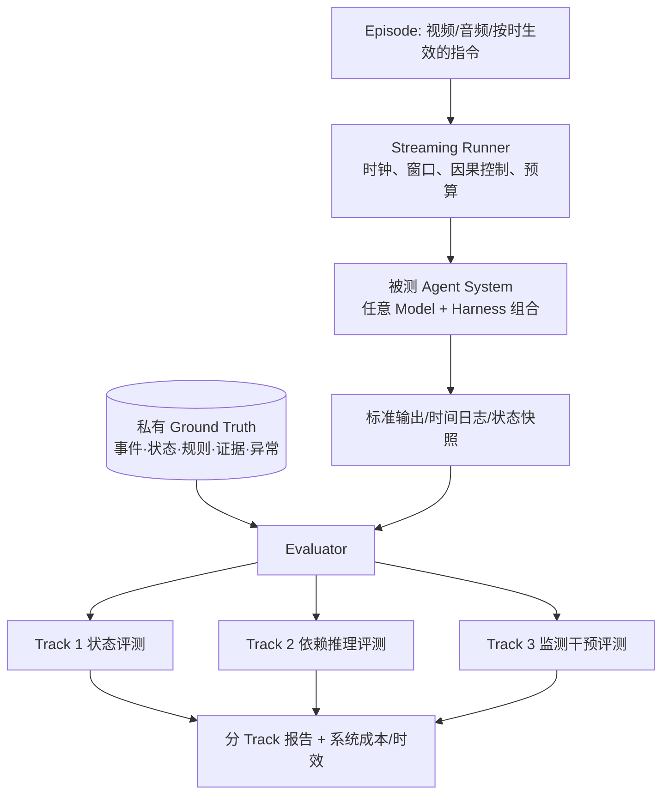

# 长程流式过程性视频 Agent System Benchmark 总体设计方案（V1.0）

> **英文暂定名称**：Long-Horizon Streaming Procedural Video Agent Benchmark（LHSP-AgentBench；工作代号，正式命名待定）  
> **版本**：V1.0（研究与工程联合设计稿）  
> **日期**：2026-10-08  
> **状态**：顶层研究目标与 Track 框架拟冻结；评分阈值、窗口参数与数据 Schema 待 Golden Episode 实证校准  
> **首期数据来源**：Ego-MC-Bench（Cooking）；后续扩展到电力作业巡检等过程性视频  
> **主要读者**：研究者、数据标注负责人、Benchmark/Agent 工程开发者  

---

## 执行摘要

本方案拟构建一个面向**长程、连续输入、具备流程与操作依赖的视频任务**的 Agent System 评测基准。评测主体是完整的 **Model + Harness 系统**，而不是预设某类模型结构、状态管理模块或记忆实现。系统应在视频回放期间遵守因果可见性约束，持续感知、记忆、推理及自主响应。

Benchmark 由一个统一 Streaming Runner、三个互补 Track 和四类系统级横向指标构成：

| Track | 正式名称 | 核心问题 | 最主要的产出 |
|---|---|---|---|
| T1 | Online Procedural State Understanding | 随视频推进，系统是否持续理解真实操作进度与对象状态？ | 按时间索引的状态与状态转移预测 |
| T2 | Long-Horizon Procedural Dependency Reasoning | 系统能否利用历史事实与当时有效的规则，解释当前操作的依赖与约束？ | 在指定时刻给出结论、证据与不确定性 |
| T3 | Continual Monitoring & Timely Intervention | 系统能否无需提醒地持续发现异常，并在合理时间内响应？ | 事件级异常报警、更新与解除 |

横向维度为 **任务质量、时间表现、长程可靠性与系统开销**。三个 Track 共享一次不重置的 Episode 执行轨迹，但评测查询不应污染系统的正常记忆。端到端系统排名为主，固定模型或固定 Harness 的受控消融为辅。

本方案明确采用**任务与评分先行、标注需求随后、Schema 最后落实**的顺序。首个里程碑不是大规模数据集，而是从 Ego-MC-Bench 选择一个 Golden Episode，证明：三类任务能够从真实视频得到可核验真值；Evaluator 可以可靠评分；在线接口无未来信息泄漏；至少一部分长程题确实无法由仅看最近窗口的方法轻易解决。

> **V1.0 边界声明**：本稿提出的是拟验证的研究贡献，而非已经证明的论文创新；对于 Ego-MC 中尚未经过逐帧复核的动作、依赖或干预时刻，绝不把转写文本推断当作已核实 Ground Truth。

---

# 1. 研究定位与问题定义

## 1.1 场景与基本假设

目标任务具有以下性质：

1. **Streaming**：视频、音频与外部指令在时间中逐步可见；系统不能事先读取整个 Episode。
2. **Long-horizon**：晚期判断可能依赖早期操作、历史对象状态或规则修订，历史与当前画面之间存在显著时间距离。
3. **Procedural**：视频中的动作不是孤立事件，而围绕步骤、对象、前置条件、目标状态及合法变更展开。
4. **Persistent system**：同一 Agent System 必须长期运行；它选择如何表示历史、何时重检、怎样构建上下文均属于被测能力。
5. **Time-sensitive**：最终答案正确并不等于在线表现优良；迟到的理解、过早干预与频繁误报必须被区分。

首期评测以预录制视频**因果回放**模拟流式输入。系统发出提醒不会改变已录制的后续行为。因此 V1 的“intervention”严格指**及时、正确的提醒输出**，不声称真实干预改变了操作结果。

## 1.2 被测对象与系统边界

被测对象定义为：
$\mathcal{A}=\{\text{Perception Model(s)},\ \text{Reasoning Model(s)},\ \text{Harness},\ \text{Memory/Tools/Policies}\}.$

Benchmark 只规定**外部契约**，不强制使用 State Manager、Vector DB、RAG、ReAct、Plan/Replan、多个模型或固定 Context Builder。单一原生流式多模态模型和复杂多模型 Agent 都可参与。

**Benchmark 管理**：视频分发、音频/指令公开时刻、时钟、资源限制、评测检查点、私有真值、评分代码。  
**系统自主管理**：内部感知、上下文、记忆、推理、缓存、检索、工具使用与主动响应。  
**记录但不要求公开**：逐步调用日志、消耗、状态快照、报警时间；若涉及封闭 API，可提交标准化审计摘要。

## 1.3 核心研究问题（Research Questions）

- **RQ1 — Continuous Understanding**：完整系统能否在长时间视频输入中持续保持正确的步骤与对象状态，而不是只识别单帧或短时动作？
- **RQ2 — Historical Necessity**：系统能否在相关历史信息已经离开近期窗口的条件下，基于跨步骤证据和当时有效规则进行正确推理？
- **RQ3 — Timely Reliability**：系统能否在完整 Episode 中持续监测多次异常、纠正与恢复，并同时控制漏报、误报和报警延迟？
- **RQ4 — System Trade-off**：在延迟、记忆和调用预算约束下，不同 Model + Harness 组合的质量—效率曲线有什么差异？

RQ1–RQ3 分别由 T1–T3 主测；RQ4 横贯全部 Track。

## 1.4 明确不做什么（V1 Non-goals）

- 不以通用开放域 VideoQA、任意物体识别或视频摘要作为主要贡献。
- 不评价真实物理干预后的结果改变（录制数据不具备反事实反馈）。
- 不要求系统使用某种内部架构，也不把 Harness 组件表现等同系统端到端能力。
- 不以虚构步骤依赖、事后推测的错误后果或任意合成问答填充样本量。
- 不在首期引入多智能体协作、开放世界工具搜索、复杂计划生成作为独立 Track。
- 不把使用专家纠错反馈后的表现计为反馈出现之前的自主识别。

---

# 2. 相关工作与可能的研究空间

| 工作 | 已覆盖能力 | 本项目可借鉴 | 不能直接重复的主张 |
|---|---|---|---|
| Ego-MC-Bench (2026) [1] | 烹饪步骤指导、错误发现与及时干预 | 时间戳指令、反馈、真实操作视频 | “做及时错误干预”本身不是新任务 |
| OVO-Bench (CVPR 2025) [2] | 历史回溯、当前理解、等待证据 | 提问时刻、因果回答、无证据时等待 | 不能仅复制流式历史 QA |
| OVBench / VideoChat-Online (CVPR 2025) [3] | 在线感知、记忆、推理 | 在线执行协议与多时间尺度任务 | 不能仅以“在线记忆任务”区别 |
| SimpleStream (2026) [4] | 最近帧基线与感知—记忆权衡 | 必做 Current-window baseline | 不能假定复杂记忆一定更强 |
| StreamArena (2026) [5] | 小时级流式 Agent、主动交互、工具与记忆 | 长程连续评测、开放式问题、系统比较 | 不能仅以“系统级流式评测”自称新颖 |
| Harnessing Streaming Video in the Wild (2026) [6] | Streaming Harness、长程记忆、主动交互 | 系统基础设施与时效评分 | 不能仅以“评测 Model + Harness”自称独特 |
| EgoPER (CVPR 2024) [7] | 过程性错误类型、对象与步骤标注 | 流程错误分类和标注规范 | 错误类型与纠正并非空白 |
| PROVIA (2026) [8] | 在线真实状态与规范进度、完整序列错误恢复 | 真实/规范进度分离、多错持续监测、误报预算 | 不能仅以“连续错误恢复”作为创新点 |

**拟形成差异化的组合**：以**过程性操作依赖**为统一任务语义，在**同一次连续系统执行**中联合评测真实状态、跨时间约束推理和无需提问的及时判断，同时报告历史必要性、证据可追溯性和系统效率。上述组合是否具有足够的学术创新，仍需通过任务审计、近邻 Benchmark 对照和消融实验验证。

---

# 3. 总体架构



## 3.1 一个 Episode，一次持续执行

运行时把视频按时间推进给系统。系统内部状态不得在 T1/T2/T3 检查点之间无故清空。Track 1 与 Track 3 的主输出通过连续事件流记录；Track 2 在指定时间触发外部 Probe，**以执行状态快照、独立分支或可证明等价的隔离机制回答**，不得让 Probe 答案反向污染后续 Episode 状态。

## 3.2 两类实验层级

**主层：End-to-End System Evaluation（论文主结果）**

- 允许 Model 与 Harness 联合变化；每个系统按统一外部协议完成相同 Episode。
- 质量、时效、误报与资源开销分别展示；采用明确的运行档位做公平比较。
- 不允许仅凭系统间差异推断“某个 Harness 模块更好”。

**辅层：Controlled Analysis（解释系统差异）**

- 固定模型，更换历史管理、状态处理、工具与调度策略。
- 固定 Harness，更换底层模型。
- 可选择 2×2 或多因素实验衡量 Model × Harness 交互效应。
- 增补 Oracle-perception 等诊断实验，但不得混入端到端主排行榜。

---

# 4. 三个 Track 的正式定义

## 4.1 Track 1 — Online Procedural State Understanding

### 4.1.1 任务定义

给定截至时间 `t` 的合法观察，系统输出对**事实上的过程状态**的估计，而不是仅重复规范要求。

**状态范围**：当前/已完成/未开始/中断/被撤销的步骤；对象及容器状态；动作与对象关联；可观察的状态转移；证据不足的未知状态。规范认可进度可作为独立参考字段，不得混作实际已发生事件。

| 子任务 | 输出 | Ground Truth 需求 | 关键难点 |
|---|---|---|---|
| T1.1 Step Progress Tracking | 步骤状态与进度 | 步骤区间、完成与取消条件 | 非线性、重复、跳步、补做 |
| T1.2 Object & Environment State Tracking | 关键对象属性及状态 | 对象 ID、可观察属性、前后状态 | 遮挡、对象转移、不可判定 |
| T1.3 State Transition Tracking | 状态改变事件与时间 | 转移时间段、状态前后与证据 | 滞后更新、长期漂移 |

### 4.1.2 输出与评测触发

- `state_update`：系统自行按约定频率/变化触发输出可审计状态；内部状态表示不限。
- `state_snapshot(t)`：Evaluator 在固定且对参评者公平的检查点读取状态。若接口需要询问，不得因此让系统重新读取未来视频，也不能改变主执行状态。
- 允许 `unknown` / `uncertain`；未知与错误必须分开评分，避免逼迫猜测不可见状态。

### 4.1.3 指标

- **State Macro Accuracy / Macro-F1**：按对象属性、步骤类别与 Episode 分层宏平均，防止大量“未开始”状态淹没困难状态。
- **Transition Precision/Recall/F1**：允许预先声明的时间容差 `δ_state`，一对一匹配真值与预测转移。
- **Update Delay**：自状态变得可观察到首次正确更新的延迟，以视频时间测量；另报告真实计算延迟。
- **Temporal Consistency / Drift**：检查不被后续观察支持的状态翻转和长程累积错误；仅对有可观察真值的区间评分。

**边界**：T1 判断“实际发生了什么”，不要求给出规范违例结论；规范判断属于 T2，是否报警属于 T3。

## 4.2 Track 2 — Long-Horizon Procedural Dependency Reasoning

### 4.2.1 任务定义

系统在指定时间 `t_q` 回答一个与**当前过程有关**的问题；回答必须依赖此前视频或按时可见指令中的多个历史事实、步骤约束或规则变化。问题与可选答案不能预先暴露给被测系统。

| 子任务 | 任务要求 | 典型答案与证据 | Ego-MC V1 地位 |
|---|---|---|---|
| T2.1 Historical Precondition Verification | 当前步骤的前置条件是否已经实际满足？ | `satisfied / unsatisfied / unknown` + 早期必要操作证据 | 核心 |
| T2.2 Instruction Revision Reasoning | 当前应当服从哪个有效指令版本？替代/豁免是否成立？ | 有效规则、修订时间与适用条件 | 核心，需足量有效案例 |
| T2.3 Historical Evidence Integration | 多段分散证据如何共同决定当前对象/操作关系？ | 结论 + 一组跨时间证据片段 | 核心 |
| T2.4 Delayed Consequence & Recovery | 早期偏差是否仍影响当前步骤，后续是否补救？ | 依据可见操作判断持续约束/恢复 | 理想版扩展；V1 默认不启用 |

### 4.2.2 每一道 Probe 的必要定义

- `query_time`：系统接收到问题的时间；不得早于所需证据在现实中可见的时刻。
- `question`、`answer_type`、`gold_answer`：明确输出空间；支持 `unknown`。
- `required_evidence_sets`：一组或多组**可替代的最小充分证据集合**，每段有来源、时段及作用（事实、规则、修订、对象转移）。
- `reasoning_relation`：依赖、修订覆盖、条件适用、对象传递等关系。
- `earliest_answerable_time`：首次证据充分的时间；若只能区间标注，则给区间。
- `dependency_span`：从必要历史最早片段到 `query_time` 的跨度。
- `visibility_regime`：何种音视频/指令/反馈对系统可见，避免专家反馈带来不公平的捷径。
- `evidence_quality`：是否直接观察、是否依赖不确定估计、标注信心与分歧。

### 4.2.3 如何保证“真长程”

**不得仅凭题目的时间跨度就认定它是长程任务**。每题须经过以下质量审核：

1. **History Necessity**：使用近期短窗口的视觉/音频和当前有效指令尝试作答；若能够稳定、无历史地得出答案，则降低其长程标记或剔除。
2. **Multi-evidence Necessity**：至少一个核心子集要求组合两处及以上非冗余证据；仅从一个事实即可回答的题单独标记为 Recall 类诊断样本。
3. **No language shortcut**：避免仅靠“通常烹饪应该怎样”或题面暗示猜出答案；需要具体 Episode 的事实证据。
4. **Temporal validity**：若同一指令前后发生合法修订，检查点必须按彼时有效版本评分。
5. **Paired diagnostic（可选）**：优先从真实视频中寻找“相似当前场景、不同历史导致不同答案”的自然对照；不得随意修改真实历史伪造事实。

### 4.2.4 指标

- **Answer Accuracy / Macro-F1**：分任务类别与答案类别评分；证据不足问题单独报告。
- **Evidence Grounding**：预测时间证据与人工审核的充分证据集合匹配。V1 可按“覆盖必要证据段比例 + 无关片段惩罚”评分；最终阈值须在开发集上冻结。
- **Revision Consistency**：跨规则更新前后的一组检查点是否均遵循当时有效规范。
- **Long-horizon Performance Profile**：按历史跨度、必需证据数、依赖深度、对象转换次数分桶报告；不能用单一跨度指标替代难度。
- **Recent-only Gap**：在统一基模、相似调用成本下，完整系统相对只看近期窗口基线的表现差异；仅作为样本有效性与系统诊断，不预设正差值。

**边界**：T2 是给定检查点的“约束与证据推理”，不评价何时应自主报警；这属于 T3。

## 4.3 Track 3 — Continual Monitoring & Timely Intervention

### 4.3.1 任务定义

系统在**没有外部逐次提问**的情况下，在完整 Episode 中监测操作是否偏离当前生效规范，并自行输出有证据支持的提醒、更新和解除。允许无异常时持续沉默。

| 子任务 | 目标 | 关键难点 |
|---|---|---|
| T3.1 Online Anomaly Detection | 识别错误步骤、错误对象、顺序偏差、遗漏及其他可核验错误 | 含正常长区间、重复错误和多类误报 |
| T3.2 Evidence-aware Timely Intervention | 在证据充足后及时提醒，不提前猜测、不拖延至无效 | 证据充分时刻不一定等于错误开始 |
| T3.3 Continuous Recovery Monitoring | 错误发生后继续运行；纠正后更新状态并识别后续异常 | 不能只测首错、不能将已修复错误无限保持 |

### 4.3.2 错误真值的时间语义

一个 Error Event 至少区分：

- `error_onset`：真实偏差开始时刻；对于遗漏可能为“已无法按规则完成前置条件”的时点，而不是任意设定的缺席时刻。
- `detectable_from`：从已可见证据客观上首次足以判断异常的时刻；可以为 `[earliest, latest]` 区间。
- `deadline`：若确有外部任务价值意义上的最晚有效提醒时刻，则标注；否则为 `null`，不得推测。
- `feedback_given_at`：视频中的指导者/专家实际指出错误的时刻（如果有），**不等同**于前三者。
- `resolved_at`：有视频证据支持的纠正完成时刻；仍未解决则为 `null`。
- `confidence / ambiguity`：明确证据质量，存在歧义的样本不得纳入硬评分。

漏步骤尤其应谨慎：只有当规则与观察使该步骤被认定为必需，且后续操作已跨过必要依赖点或操作窗口已关闭时，才能定义可靠的检测时刻。

### 4.3.3 报警输出与事件匹配

标准输出应支持 `raise` / `update` / `resolve`，至少携带 `video_time`、`emission_wall_time`、`category`、`message`、`evidence_refs`、`incident_id`。报警输出不得依赖 Evaluator 在当下提供隐藏的错误答案。

对预测报警与真值错误进行**同类别、时间合理、事件级一对一匹配**；同一错误的重复报警不能重复获得 TP。对于误报恢复、非错误区间和相邻事件，匹配策略应明确并公开。

### 4.3.4 指标

- **Event Precision / Recall / F1**：基于真值事件的一对一匹配，不把每个视频帧当作独立错误样本。
- **Timely Recall**：在 `[detectable_from, deadline]`（有截止点）内正确报警的错误比例；无截止点则单独报告检测延迟分布，不凭空判“过期”。
- **Detection Delay**：从首次可检测时刻到首次正确报警时刻的视频时间差；对早于证据充分的报警另计过早报警。
- **False Alarms per Hour (FA/h)**：误报事件数 / 有效受测视频小时数，配合误报持续时间指标；完整正常 Episode 必须计入。
- **Recovery Tracking**：已纠正错误的解除正确率、解除延迟、解除后重复误报。

**限制**：反馈后识别到已被专家明示的错误，应与反馈前的自主识别分别统计。不能用后者代替前者。

---

# 5. Streaming Evaluation Protocol（统一执行协议）

## 5.1 时间与因果边界

必须分别记录三种时间：

1. **Media time（`t_media`）**：视频自身时间轴，所有证据、状态和事件真值的基准。
2. **Availability time（`t_available`）**：Runner 实际向系统公开某帧、语音段或指令的时刻；只能使用 `t_available <= 当前时钟` 的输入。
3. **Wall-clock time（`t_wall`）**：真实进程耗时，用于计算延迟、吞吐、积压和系统成本。

任何回答在 `t_q` 时刻的任务只能引用那时已经公开的媒体或指令。长时间模型调用完成时如流媒体时钟已推进，需标明**请求开始时可见的视频截止位置**和**结果实际发出时刻**，防止把迟到答案错误计为及时。

## 5.2 输入通道与指令可见性

- **视频/音频**：以真实 MP4 为信息来源，按照 Runner 的可配置窗口推送；不得擅自读取未公开的后续帧。
- **原始指导者指令**：可作为随时间输入的任务规范；只在音频出现、字幕送达或 Runner 正式释放后生效。
- **原始指导者反馈**：保留发生时间和“反馈/监督”身份，区分自主检测前后。
- **GT/事件图/人工标注**：Evaluator 私有；不能作为主评测系统的在线输入。

建议定义两种可复现实验条件：

**G1 — Natural Guidance（主设定）**：视频与原始音频按照时间输入；如提供转写，仅允许逐段、在真实说话时间之后释放，同时对所有系统统一。适合评测真实交互中的整体表现。

**G2 — Intervention-Independent Diagnostic（辅设定）**：针对“专家反馈泄漏”设计事前检查点、反馈前观察或在严格定义下屏蔽/隔离答案性反馈；须清楚写明改变了哪些模态和信息，不可与 G1 排行结果直接混合。

不要将原始完整菜谱、未来指令、完整专家反馈在开始时一次性交给系统。

## 5.3 Runtime 接口（概念契约，非固定实现）

```text
initialize(episode_public_metadata, protocol_config)
on_observation(window, availability_time) -> optional state_update / alarm
on_instruction(instruction_event, availability_time) -> optional output
query_snapshot(query, at_media_time, isolated=true) -> answer   # Track 2
flush() -> final trace and usage logs
```

内部如何编码窗、提取帧、保存 Memory、调用模型或工具不做要求；但每个系统必须统一输出协议和时钟语义。

### 统一系统输出示例（示意，非最终 Schema）

```json
{
  "episode_id": "EXAMPLE_ONLY",
  "media_time": 620.0,
  "output_type": "alarm",
  "incident_id": "incident-02",
  "category": "missing_precondition",
  "decision": "raise",
  "confidence": 0.78,
  "evidence_refs": ["public-observation-103", "public-observation-211"],
  "emission_wall_time_ms": 1870034900000
}
```

上例只说明接口形态，不是从真实 Ego-MC 视频导出的错误事实。

## 5.4 Track 2 Probe 的无污染机制

优先方案：运行到 `t_q` 后冻结同一 Agent 状态；复制状态到只读评测分支回答 Probe，评测后丢弃该分支；正常执行从原状态继续。

对于闭源系统无法复制状态的情况，可采用**预先声明的等价隔离策略**（例如独立持久会话的影子运行），并在实验报告中标识其额外成本。若隔离不可实现，应把其结果标为受 Probe 干扰的研究性数据，而不是与无污染主设置混算。

## 5.5 两种回放/实时性能模式

- **Causal Replay（必做）**：严格按照媒体时间发布内容，但不强制实时节奏；主要衡量在线因果正确性与长程任务质量。
- **Real-time Replay（推荐）**：以 1× 视频速度发布内容，记录模型调用是否跟得上，积压视频时间、超时、丢窗和响应延迟；可另设加速/减速诊断。

二者必须分表报告。不能把无需满足实际吞吐的回放成绩当作实时部署能力。

## 5.6 参数与预算

窗口长度、采样帧率、检查点密度、Probe 超时、事件匹配容差、历史容量等先作为配置项，由 Golden Episode 和开发集确定后冻结。

建议至少提供：

- **Fixed-budget profile**：统一资源上限（视频访问、历史检索、上下文、模型调用/工具调用等可审计约束），用于受控横向对比。
- **Open-system profile**：允许不同模型与 Harness 组合，在清楚报告资源成本及合规性的情况下比较系统能力，主要呈现 Pareto 曲线，不用单一总分掩盖成本。

原生长上下文系统与检索系统可采用不同策略，但必须明确实际可访问的历史视频/原始数据范围。外部工具只允许检索已经公开且属于当前 Episode 的历史资源；禁止访问测试 GT、未来帧和外部答案库。

## 5.7 完整性与可审计性

每次运行至少保存：系统版本、模型名称/版本、温度和随机种子（适用时）、Runner 配置、输入哈希、输出时间线、资源使用、异常/超时日志、结果哈希。检验工具负责检查未来信息引用、时间倒退、重复事件 ID、缺失窗口与日志不一致。

---

# 6. Ground Truth 与标注需求

## 6.1 “先 Task，后 Schema”的数据原则

不要为了填满大量字段而标注。Ground Truth 应只包含支持任务判定、证据追溯、时间一致性与质量审计所需的事实。

建议内部建立六类可互相关联的标注层：

| 层 | 内容 | 支撑 Track |
|---|---|---|
| L0 Media & Source | 视频 ID、时长、来源、原始时间戳指令/反馈、视频片段引用 | 全部 |
| L1 Normative Procedure | 已公开的步骤要求、前置条件、合法替代、修订版本与有效期 | T2、T3 |
| L2 Observed Events | 观察到的动作、对象、参与者、开始/结束时间、来源证据 | 全部 |
| L3 Factual State / Checkpoints | 对象状态、步骤事实状态、不可见/未知状态、状态转移 | T1、T2 |
| L4 Dependency / Reasoning Probe | 关系、最小必要证据、问题、答案、可回答时刻 | T2 |
| L5 Error / Intervention | 偏差类型、开始、可检测时刻、反馈、截止点、修复 | T3 |

必须区别：

- **实际发生（observed）** 与 **规范要求（normative）**。
- **可见但不确定（uncertain）** 与 **无法观察（unknown）**。
- **用户/指导者原话** 与 **标注者整理的结论**。
- **原视频直接证据** 与 **标注推断或常识假设**。
- **真实专家反馈发生时间** 与 **最早可能自主发现时间**。

## 6.2 关系与有效期

每个指令记录可定义 `issued_at`、`effective_from`、`supersedes`、`condition`、`scope`、`source`。规则修订是否真正替代旧规则，需要依照上下文人工复核；单纯出现 `Instruction-Clarification` 标签不足以证明替代关系。

每个步骤依赖需明确类型，例如：`requires_step_completed`、`requires_object_state`、`uses_output_of`、`overrides_rule`，并记录证据。拒绝通过模型常识为视频补造不存在的操作链。

## 6.3 标注流程和质量控制

1. **原始素材冻结**：核对视频可读取性、时长、音画同步和许可；保留原始时间戳。
2. **证据收集**：人工或辅助模型生成候选操作事件，不直接晋升为真值。
3. **规范—事实分离**：分别记录指导者要求与实际动作、对象状态。
4. **Track 1 标注**：步骤状态及关键对象转移，优先关键检查点，再增密时序。
5. **Track 2 标注**：只针对有真实证据的前置条件、规则修订及多证据关系构造 Probe。
6. **Track 3 标注**：核对真实错误、可检测区间、专家反馈、是否已修复与是否有客观截止点。
7. **独立复核与裁决**：困难证据链和干预时点由第二标注者复核；分歧经仲裁保留版本记录。
8. **质量门禁**：全部跨文件 ID 可解析；引用时间不越界；先因后果/生效期合法；有歧义且未裁决的样本不得进入硬评分。

对跨时间事实的标注一致性建议同时报告：任务答案一致率、时间边界差值分布、证据集合重叠，以及裁决比例。不要仅报告 JSON Schema `PASS`。

## 6.4 自动校验应包含

- JSON 类型/枚举/必填项与外键完整性。
- 视频引用范围、事件时间排序、指令生效期及修订图是否成环。
- 依赖关系是否存在不可解释的环、孤立引用或未来证据。
- 每个 Probe 在查询时刻之前已具有足够证据；`gold_answer` 可通过证据与规则解释。
- 每个报警真值时间语义自洽；若 `deadline` 存在，不早于 `detectable_from`。
- 正常 Episode、无错窗口、困难负样本进入相应评测分母。
- 顶层 Episode Manifest 明确标注成熟度：`RAW`、`CANDIDATE`、`REVIEWED`、`GOLD`。

## 6.5 Schema 冻结策略

**Phase 1 只冻结逻辑实体、ID 关系、时间语义与必需输出契约**。  
**Golden Episode 之后再冻结可执行 JSON Schema V1.0**，避免用未经过实证的数据结构绑死研究任务。后续扩展以带版本迁移的方式演进。

---

# 7. Metrics、汇总方式与统计方法

## 7.1 评分总原则

- 以 Episode 为基本统计单元，先算 Episode 分，再跨 Episode 取宏平均，避免长视频因检查点多而支配总分。
- T1、T2、T3 **分别发布主指标**；默认不做将各指标简单加权相加的唯一榜单分数。
- 误报/延迟/资源开销与准确率并排报告，不以高准确率掩盖不可部署的开销。
- 报告每个指标的分母、有效样本数、跳过/弃权比例和标注不确定性。

## 7.2 关键指标的定义建议

**T1 状态准确率**：

\[
\mathrm{StateAcc}=\frac{1}{|Q|}\sum_{q\in Q}\mathbf{1}[\hat{s}_q=s_q],
\]

其中 `Q` 为已审定、可观察的状态检查项；多类字段应按字段/状态类别宏平均，未知类依评测规则独立处理。

**T1 转移 F1**：同类型转移在时间容差 `δ_state` 内一对一匹配，按 Precision、Recall、F1 计算。

**T2 Probe Accuracy**：逐任务类别计算答对的 Probe 比例，再宏平均；不可判定问题需要允许并核实 `unknown` 类。

**T2 Evidence Score**：预测证据与任一“最小充分证据集合”比较，计算必需片段召回和附带无关片段惩罚；不得只靠格式漂亮获得高分。时间片段可设 IoU 阈值或容差，均在开发集确定。

**T3 Event F1**：通过事件级一对一匹配得到 TP/FP/FN，

\[
F_1=\frac{2TP}{2TP+FP+FN}.
\]

**T3 False Alarms per Hour**：

\[
\mathrm{FA/h}=\frac{\#\text{unmatched alarm incidents}}{\text{evaluated video hours}}.
\]

**T3 Detection Delay**：匹配报警首次发出时的媒体时刻，减去对应错误 `detectable_from`；若可检测时间为区间，报告区间延迟或在明确的边界约定下评分。

**系统实时性**：在线时间积压 `backlog = t_available_media - t_processed_media`、响应真实耗时分布（P50/P95）、丢弃窗口率、吞吐/实时因子。

**系统效率**：模型输入/输出 Token、视频帧/时长访问量、API/工具调用数、显存或 GPU 时间（能记录时）、成本；报告运行平台与计费版本。

## 7.3 长程诊断切片

每个 Track 需要按以下至少部分维度出报告：

- 视频进行到前/中/后期时的表现。
- 必需历史跨度（连续变量及分桶）。
- 最小证据集合大小、依赖推理深度、对象转换次数。
- 规则发生修订/未修订。
- 无错、首错、后续错误、纠正后继续操作。
- 专家反馈前/反馈后。
- 使用历史高成本系统与最近窗口低成本系统的差异。

长程能力成立的必要条件不是“长视频平均分高”，而是**在控制近期视觉提示和语言先验后，远距历史确实带来可靠增益**。

## 7.4 统计检验与报告

- 按 Episode/原视频聚类做 Bootstrap 置信区间；相同 Episode 上配对比较系统结果。
- Pilot 阶段样本量小，不作显著性或排名的过度解释。
- 若一次视频产生大量高度相关 Probe，统计有效样本单位不能错误地视为独立问题。
- 给出错误案例分析、性能随时间变化曲线与“有效指标样本数”，不只报总体均值。

---

# 8. Baselines 与实验矩阵

## 8.1 主实验至少包含的系统类别

| Baseline | 定义 | 目的 |
|---|---|---|
| B0 Recent-window | 同一视频模型，仅给当前/最近 N 帧及合法当前指令 | 验证历史必要性、抵御简单捷径 |
| B1 Growing / Truncated History | 不做专门事件记忆，按上下文上限不断添加历史并截断 | 基础长上下文参照 |
| B2 Rolling Summary | 持续压缩文本/多模态历史摘要 | 简单 Harness 参照 |
| B3 Retrieval Memory | 按需检索历史观察或事件证据 | 长程检索参照 |
| B4 Stateful Agent | 显式过程状态、对象状态、规则版本和记忆管理 | 系统化状态参照 |
| B5 Full-history Reference（若可行） | 在能力/预算允许时读取更完整历史 | 高成本诊断上限，不是神谕 |

在跨系统主榜上允许其它架构。B0–B5 只是研究基线，不构成参评资格限制。

## 8.2 消融实验

- 固定视觉/推理模型：无记忆、滚动摘要、检索、显式状态/规则版本。
- 固定 Harness：更换单模态/多模态感知与推理模型。
- 有无音频/指令；有无答案性专家反馈的事前识别切片。
- 固定历史预算下改变窗口长度、检查点密度与事件记忆大小。
- 有/无主动工具使用、重检机制；每种设置都计实际额外开销。
- 报告 Model × Harness 交互作用，而不是默认二者贡献可简单相加。

## 8.3 重要防作弊/防捷径基线

- **No-video / Instruction-only**：检验仅凭任务惯例或指导者原话可以答对多少。
- **Timestamp-only**：检验是否仅用时间猜测错误（PROVIA 已指出这类风险）。
- **Current-only**：检验长程 Probe 是否能由近期窗口解决。
- **Shuffled history diagnostic**：保持当前窗口，对历史顺序进行受控扰动的离线诊断；不得作为真实在线主分数。

---

# 9. Ego-MC-Bench 数据落地方案

## 9.1 公开数据现状与限制

Ego-MC-Bench 是面向真实烹饪操作及及时错误纠正的视频评测工作 [1]。公开数据页面描述了视频与 `texts`、`text_types`、`text_timestamps` 对齐的指令/反馈标注；其文档列出 40 段视频、1,597 条标注，但公开查看器当前显示的行数可能与 Release 描述不一致，实际项目须以下载归档和校验 Manifest 为准 [9]。

用户之前准备的子集公开说明为 **7 段视频、253 条标注** [10]。其标签覆盖 Instruction、Success、Feedback、Instruction-Clarification、User-Comment、User-Question；**不是**完整的逐帧操作真值、依赖图或错误时间定义。旧版 Schema 可不兼容重建，但原始媒体、原始标注与来源记录必须保留。

**首期新增数据必须经过视频核验**：是否真正完成动作、使用哪个对象、对象是否发生状态改变、反馈前是否存在足够的自主检测证据、某次澄清是否构成规则替代。

## 9.2 现有样本与 Track 适配

| Track | 候选数据来源 | 必需的新增审核 | 风险 |
|---|---|---|---|
| T1 | 原始指令/完成反馈 + 视频中的动作、对象 | 步骤事实、对象状态、转移时间及未知状态 | 反馈不等于实际完成 |
| T2.1 | 烹饪流程中的早期准备与后续使用 | 前置关系、必要历史证据及最早可回答时间 | 可能被当前画面或常识直接回答 |
| T2.2 | Instruction-Clarification 与交互替代方案 | 指令版本、实际生效关系与时间 | 澄清稀少或语义不等于替代 |
| T2.3 | 多阶段食材/容器转移 | 对象连续性及跨时间证据链 | 遮挡与对象追踪歧义 |
| T3 | 原始 Feedback、部分 Success 与无错误区间 | 错误开始、可检测区间、纠正时间与正常负样本 | 反馈时间不能冒充最早检测时间 |

## 9.3 Golden Episode 选取策略

**主 Golden Episode（候选）**：`GX010021`。基于已有文字标注，它包含指令澄清与材料替代，适合率先验证规则版本化、状态/事实分离及反馈前后信息边界。**尚需实际视频核验，不能宣称已具备完整跨时间真值。**

**补充覆盖（候选）**：`GX010053`。其较长操作过程可作为 T2.1/T2.3 的第二样例，检查跨阶段对象连续性和较远距离依赖是否确实可由视频支持。

优先顺序：一个 Episode 做全链条标注与评分；若单视频无法覆盖某个 Track 的关键情形，允许增加第二个**针对性补充样例**，而不是为了“一个视频覆盖所有子任务”伪造事件。

## 9.4 Golden Episode 的完整交付

必须交付：

1. 原始视频及校验 Manifest（或有授权的可读取链接与哈希）。
2. 原始时序指令/反馈层，不改写源事实。
3. 关键 Procedure、Observed Event、State Checkpoint、Dependency Evidence、Error Event 真值。
4. T1/T2/T3 小规模可评分任务及人工裁决记录。
5. 可运行的 Replay Manifest、输入/输出轨迹与评分报告。
6. 用 B0 与至少一项历史增强系统完成的有效性对照。
7. 明确说明**哪些理想任务因数据缺口暂时无法构造**。

## 9.5 数据集扩大与划分

- Golden（1–2 段）只用于协议和标注设计，不用于声称 Benchmark 泛化性能。
- Pilot（约 5–10 段）用于标注一致性、难度分布、Baseline 区分度及运行可靠性。
- 正式版才制定严格训练/验证/测试分层：按**完整原视频/参与者/任务变体（如有）**去重分组，避免相关片段跨集合泄漏。
- 对于样本数量较少的 Ego-MC，不能强行把 7 段子集拆成具有可靠统计功效的三分数据集；必要时扩展来源或明确研究为可行性 Pilot。
- 检查原视频使用许可、二次分发权限及原论文引用要求。

---

# 10. 实施阶段、验收门禁与优先级

| 阶段 | 工作内容 | 阶段交付 | 继续下一阶段的必要条件 |
|---|---|---|---|
| **P1 顶层设计（当前）** | RQ、三个 Track、协议、真值需求、Metrics 和 Baseline | 本设计文档及评审决议 | 每个子任务都有输入、输出、可评分真值与不泄漏协议 |
| **P2 Golden Episode** | 选择并人工核验 1 个视频；补充必要标注 | Golden 数据与审核报告 | 关键推理链/状态/错误可证实；无法支持的任务诚实标记 |
| **P3 Minimal Runner & Evaluator** | 连续回放、时间控制、状态/Probe/Alarm 接口及评分 | 可复现单视频结果 | 因果审计通过，能同时跑 T1/T2/T3，日志与指标可重算 |
| **P4 Pilot** | 5–10 个 Episode，抽检与复标 | Pilot 评测集、Baseline 和误差分析 | 标注一致性可接受；有效长程题显著非捷径；预算可复现 |
| **P5 正式 Benchmark** | 扩容、可靠划分、密封测试、文档发布 | Benchmark Release / 论文实验 | 统计可信、相关工作近邻对照充分、许可审计完成 |

## 10.1 P1 完成的判定标准

- RQ 与 Track 间无明显重复；Track 2 不是普通历史事实回忆的简单改名。
- 每个子任务有可执行的 **输入条件 / 输出类型 / Ground Truth / Metrics / 失败类别**。
- 已明确视频与音频可见性、反馈泄漏、时间定义、Probe 隔离、资源档位。
- 任何未确定阈值或窗口长度都标记为 `TBD + 校准方式`，不在没有数据验证的情况下伪精确。
- 文档能直接指导标注试验与 Runner 设计。

## 10.2 P2–P3 的最小闭环验收

以下是**质量门禁**，不是声称所有系统必须达到某个性能百分比：

- 所有 Gold 问题与错误有可复核证据，时间/引用无逻辑冲突。
- 每个启用的 Track 至少产生一组能运行的评测样本；缺失的任务必须报告其数据缺口。
- 构造故意越界读未来帧的测试系统时，Runner 必须阻止或检测违规。
- T2 Probe 不允许在正常执行之前泄漏题目；无污染策略有实测证据。
- Event 匹配的 TP/FP/FN 与时间延迟计算有单元测试覆盖。
- 至少执行一次完整视频和一个简单基线，并保存足以重算结果的 trace。
- 必须报告近期窗口基线表现；若大部分 T2 题无需历史，则退回任务设计，而不是掩饰结果。

---

# 11. 风险清单与决策策略

| 风险 | 对 Benchmark 的影响 | 缓解措施 |
|---|---|---|
| Cooking 视频的长程依赖不足 | T2 缺乏区分力 | 先做证据可行性审计；必要时补充新数据源，而不是造假 |
| 指令/反馈本身泄漏答案 | 虚高的 T2/T3 成绩 | 真实可见时间与反馈身份标记、事前/事后分开评分 |
| GT 以文本推测视频事实 | 标注错误与不可复现 | 双层来源管理、关键事件逐帧核验、裁决日志 |
| 历史题被当前窗口/常识解决 | 测不到长程能力 | Recent-only、No-video、自然对照及证据必要性测试 |
| 连续报警评测只看第一次错误 | 违背真实运行场景 | 全 Episode、多错、纠正与正常时间段一起评分 |
| 标注时间边界难以精确 | 误判早报/晚报 | 允许时间区间与不确定标签、阈值敏感性分析 |
| 系统成本差距很大 | 排名不公平 | 同时提供 Fixed-budget 与 Open-system，公布成本曲线 |
| Probe 改变系统记忆 | 后续 Track 被干扰 | 快照/分支隔离，隔离不可行的结果明确标识 |
| 视频回放不等于真实交互 | 干预有效性外推过度 | 明确仅评测时效与建议正确性，后续另建交互环境 |
| 正式论文创新性与近邻重叠 | 无法突出贡献 | 把程序性历史依赖、完整系统持续评测和验证性 Baseline 作为实验主轴 |

---

# 12. V1.0 已决事项与待校准事项

## 12.1 建议冻结的决策

1. **被测主体**：完整 Agent System（Model + Harness），端到端结果优先。
2. **核心场景**：长程流式过程性视频；V1 使用 Cooking，最终面向作业巡检迁移。
3. **三个 Track**：T1 过程状态、T2 长程依赖、T3 持续监测与及时干预。
4. **一次持续执行**：三个 Track 共享同一个因果 Episode，不按问题重置。
5. **外部协议中立**：统一输入输出、时钟和评分，不限制 Harness 内部结构。
6. **GT 私有与证据可追溯**：指令/反馈与真实动作分离，不能提前公开未来。
7. **Ego-MC 首期作可行性验证**：先 Golden，再 Pilot，再正式发布。
8. **不强制单一总分**：按 Track 展示效果，横向报告延迟、可靠性和成本。

## 12.2 需在 Golden / Dev 阶段确认

| 项目 | 当前状态 | 决策依据 |
|---|---|---|
| 视频时间窗口与抽帧策略 | TBD | 识别粒度、运行开销与覆盖率实验 |
| T1 Checkpoint 间隔与时间容差 | TBD | 标注边界分歧、变化事件密度 |
| T2 Probe 密度、依赖跨度分桶 | TBD | 真正可构造的长程证据数量与 Recent-only 表现 |
| T2 Evidence Score 匹配策略 | TBD | 人类证据集的一致性与候选检索可重复性 |
| T3 Alarm 匹配阈值及时间容忍 | TBD | 错误可检测区间的人工复核分布 |
| T3 误报预算/主要工作点 | TBD | 开发集上兼顾 Precision、Recall 与 FA/h |
| 实时模式超时与处理策略 | TBD | 硬件/API 平台实测与目标应用要求 |
| 主排行榜是否设计辅助综合指数 | 默认暂不设置 | Pilot 中分析指标冗余及排序稳定性 |
| Ego-MC 能否覆盖全部 T2 核心任务 | 待视频核验 | Golden Episode 和第二候选视频证据审计 |

---

# 13. 下一步可直接执行的工作项

**任务 A — Design Review**：逐项评审三个 Track 的任务契约，确认 T2 三个核心子任务与 T3 反馈泄漏控制；形成评审意见和 V1.1 变更单。

**任务 B — Episode Audit**：获取 `GX010021` 原视频与原始标注；做时间轴清单，找出可直接观察、推断不确定和不可判断的事实。

**任务 C — Annotation Blueprint**：只针对所选 Episode 设计最小实体表与对应的人工审核表，形成 2–3 个可核验的 Probe 示例、状态检查点和错误事件示例；不要先批量生成问答。

**任务 D — Evaluation Contract**：依据本方案固定媒体时钟、可见性日志、Probe 隔离和报警事件 JSON 的外部协议，编写最小 Runner/Evaluator 接口测试。

**任务 E — First Baseline**：至少跑一个 Recent-window 系统与一个带持续历史的系统，优先检查是否确有可解释的历史增益；性能差异不足也是重要的设计反馈。

**建议第一个真正的里程碑**：`GX010021` 在三个 Track 的可行部分形成“原始视频 → 审核 Ground Truth → 连续系统运行 → 自动计分 → 证据回溯”的端到端闭环。若其 T2.1/2.3 证据不足，使用 `GX010053` 作为补充验证，而不是改变评测定义去迎合数据。

---

# 附录 A. 术语表

| 术语 | 含义 |
|---|---|
| Episode | 一个完整、按时间播放的过程性视频实例 |
| Agent System | 模型、Harness、记忆、工具及控制策略的完整组合 |
| Factual State | 由视频实际观察支持的操作/对象状态 |
| Normative Procedure | 特定时刻有效的步骤与操作约束 |
| Ground Truth (GT) | 经审查的标准事实、时间、关系及答案；不一定对 Agent 可见 |
| Probe | 在指定时间提出的独立评测问题，特别用于 T2 |
| History Necessity | 必需历史信息无法仅由近期输入和题面稳定替代 |
| `detectable_from` | 最早有足够证据可客观发现异常的时间或时间区间 |
| `feedback_given_at` | 视频内指导者实际反馈时刻；非自主检测真值 |
| Causal Replay | 严格只看过去但不要求真实处理速度的回放 |
| Real-time Replay | 同时满足因果可见性并测试能否跟上实时输入 |

# 附录 B. 参考文献与数据链接

> 下列条目用于设计依据；正式论文引用请在投稿前统一核对最终版本、会议归属及著录格式。

1. Bhattacharyya et al. **Streaming Interventions: Can Video Large Language Models Correct Mistakes as They Occur?** (Ego-MC-Bench), 2026. https://arxiv.org/abs/2606.09547
2. Niu et al. **OVO-Bench: How Far is Your Video-LLMs from Real-World Online Video Understanding?** CVPR 2025. https://openaccess.thecvf.com/content/CVPR2025/html/Niu_OVO-Bench_How_Far_is_Your_Video-LLMs_from_Real-World_Online_Video_CVPR_2025_paper.html
3. Huang et al. **Online Video Understanding: OVBench and VideoChat-Online.** CVPR 2025. https://openaccess.thecvf.com/content/CVPR2025/html/Huang_Online_Video_Understanding_OVBench_and_VideoChat-Online_CVPR_2025_paper.html
4. Shen et al. **A Simple Baseline for Streaming Video Understanding.** 2026. https://arxiv.org/abs/2604.02317
5. Zhang et al. **StreamArena: Toward Continuous, Interactive, and Long-Horizon Agentic Streaming Video Understanding.** 2026. https://arxiv.org/abs/2608.05703
6. Yao et al. **Harnessing Streaming Video in the Wild.** 2026. https://arxiv.org/abs/2606.08615
7. Lee et al. **Error Detection in Egocentric Procedural Task Videos.** CVPR 2024. https://www.khoury.northeastern.edu/home/eelhami/egoper.htm
8. Wen et al. **PROVIA: Procedure State Tracking for Online Mistake Detection in Egocentric Videos.** 2026. https://arxiv.org/abs/2609.20638
9. **Ego-MC-Bench 公开数据页**：https://huggingface.co/datasets/neuripsedtracksub/ego-mistake-corrections
10. **Ego-MC-Bench 7 视频抽样子集**：https://huggingface.co/datasets/neuripsedtracksub/ego-mistake-corrections-subsampled

---

**文档结论**：本方案建议在研究层面先冻结“三 Track + 单次持续执行 + 端到端系统评测 + 长程历史必要性验证”的核心设计；所有依赖具体视频的字段、阈值和难度划分，必须通过 Golden Episode 的视频证据审计与初步 Baseline 结果再冻结。这样既保留学术问题的稳定性，也防止因现有 Ego-MC 原始标注不足而过早固化错误的 Schema。
